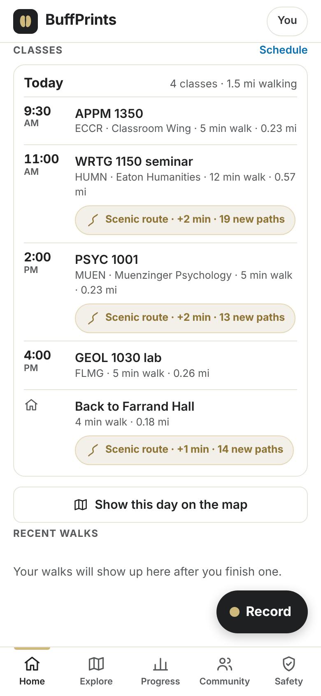
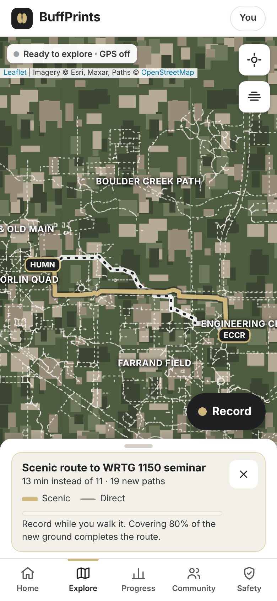

# Class schedule → commute

A student imports their Buff Portal class schedule. BuffPrints turns it into each class day's walks and ties
those walks into the game with **scenic routes**: a route to class that takes a minute or two longer but covers
paths the student hasn't walked.

 

## What the student sees

- **Home → Classes.** The next class day (today until the last class ends, then the next one): each class with its building,
  walk time and distance, the walk back, and a **Scenic route** chip where one is worth it.
- **Next card.** Within 3 hours of a class with a scenic option, the Next card suggests it. While a scenic route is
  in progress, it shows how much is walked.
- **Explore.** Tapping a chip draws the direct route (dashed) and the scenic route (gold), with building labels. The sheet
  shows the time trade-off and a progress bar.
- **Completing it.** Recording while walking the scenic route and covering 80% of its new ground completes it (toast +
  vibration). A scenic route stays active for its class day.
- **Badges.** Scenic Route (1), Road Less Traveled (5), Know Your Way (every route of one class day walked).
- **Schedule screen** (Home → Schedule, or Progress → Class schedule): where you start (residence halls and courts, campus
  parking garages, or a spot you tap), the class list, buildings to place, replace file, remove schedule.

## Privacy

- The file is read on the phone. Kept: course code and title, component (lecture, recitation…), days, times, first/last
  date, skipped dates, **building code**. Discarded during parsing and never stored: room numbers, instructors, sections,
  class numbers, and every other field. Tests check this.
- Stored under its own `localStorage` key, never uploaded or synced. Included in Export; removed by Remove schedule,
  Erase this device and Delete account. Reset progress keeps it (it's a setting, not progress).
- The privacy notice (in the app and `PRIVACY.md`) lists it.

## Reading Buff Portal files (`schedule-core.js`)

Handles the RFC 5545 and CU quirks listed for Buff Portal exports:

| Quirk | Handling |
|---|---|
| Line folding (CRLF + space or tab) | Unfolded before any field is read |
| Escapes `\,` `\;` `\n` `\\` | Unescaped in SUMMARY, LOCATION, DESCRIPTION |
| Lecture + recitation as separate VEVENTs | Kept as separate classes; same building back to back becomes one stop |
| `TBA`, `REMOTE`, `ONLINE`, blank, arranged | Marked online; no walk |
| `ECCR 265`, `Engineering Center, ECCR 265`, `HUMN 1B50` | Building code kept, room dropped |
| `EXDATE` (one per line or comma lists, TZID or UTC) | Skipped dates |
| `TZID=America/Denver`, floating, or UTC `Z` times; UTC `UNTIL` | Converted to Boulder wall-clock time |
| `COUNT`, `INTERVAL`, `DURATION`, `VALARM`, `STATUS:CANCELLED`, non-weekly repeats | Supported, ignored or reported as "not included" |
| 3–4 letter subjects, lettered sections (`011B`, `102R`) | Parsed; section discarded |

The app runs entirely in the browser, so it uses a small purpose-built parser instead of the Python `icalendar` /
`recurring-ical-events` libraries. It only needs weekly class patterns, and the tests cover each quirk above.

**CU calendar.** `TERMS` holds Fall 2026 and Spring 2027: Labor Day, fall break and Thanksgiving, MLK Day, spring break,
midsemester reading days (treated as no classes), Monday-schedule Fridays (Dec 4, Apr 23), and the last day of classes.
Regular meetings stop there even though Buff Portal repeats run into finals week. **Update this each year.**

## Buildings (`buildings.json`)

Built from OpenStreetMap by `scripts/build-buildings.mjs` (same GitHub Action as the walkways). CU codes come from each
building's `short_name`. `data/building-aliases.json` fixes codes OSM lists differently (ONKA = WVE, LBB = EDUC, CIRES = CIRE…)
or only by name (Arnett, CASE). Checked against the CU campus map export: median difference 13 m. The campus map data is
not bundled.

A code that's in neither source (for example FLMG) asks the student to **tap the building on the map** once; the pin stays on
their phone.

## Routing

The walkways form one network (97% of points connected). Routes run on it with Dijkstra from the walkway point nearest any
corner of the start and end buildings. Walking pace 1.3 m/s.

A scenic route is offered when it adds at most 25% (between 120 m and 300 m) and covers at least 40 m more unwalked ground
than the direct route. Candidates come from discounting unwalked pieces and penalizing the direct route's own pieces, so a
brand-new player also gets a real alternative.

## Limitations

- **Not tested with a real Buff Portal export.** Built from the two sample files and the quirk list; a real file may still
  differ. Test files are in `tests/fixtures/`.
- **Not tested on a physical phone or with real GPS.** Browser tests used simulated GPS along the route.
- Assumes the student stays on campus between classes; it doesn't model going home at lunch or a dining stop.
- East Campus buildings (AERO, SEEC, BIOT…) are outside the mapped walkways, so those walks are straight-line estimates
  marked "outside the mapped walkways".
- OSM splits sidewalks into short pieces, so "new paths" counts run high (same as the weekly goal).
- `buildings.json` in this branch was built from building centers fetched today; the GitHub Action adds outlines (and
  multi-storey parking such as the Euclid AutoPark) on its next run after merge.
- The term calendar needs a yearly update.

## Tests

- `node --test tests/schedule-core.test.cjs` — 9 tests: both sample files, privacy (no rooms/instructors kept), folding,
  the quirk file, CU calendar rules, day stops, routing and scenic selection, and a real Farrand → ECCR route.
- Browser checks (headless Chrome, simulated GPS): import, start pick, tap-to-place, Home card, scenic route on the map,
  walking it completes the quest and awards Scenic Route, quest survives reload, bad file, online-only schedule,
  Monday-schedule Friday, remove schedule, erase device, desktop layout; axe accessibility scans clean.
